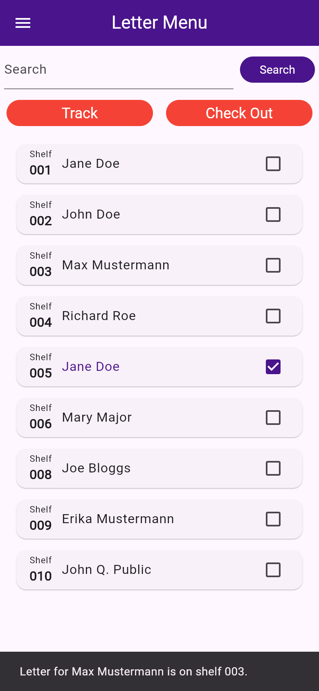
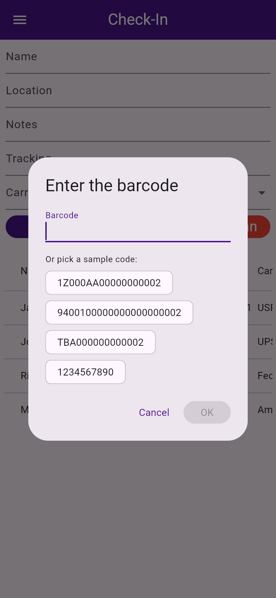
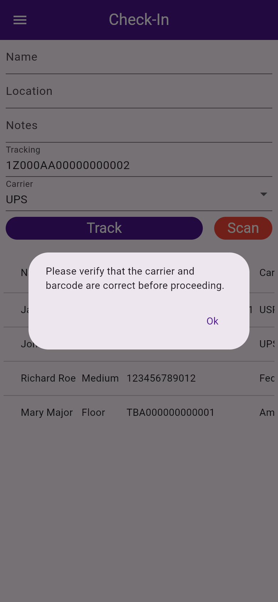

# Hermes Tracker

A Flutter app for a university mail center: the staff check packages and letters in, find them when a student comes to the window, and check them out. This repository has an early prototype of our team's app and the two features I wrote for the final version, the Letters menu and the Scan button, updated in 2026 so that they run on current Flutter and in a browser.

This was a Spring 2020 student team project at Florida Polytechnic University, for the campus mail center. It is not an official Florida Polytechnic University app.

Team: [Adam Ghaffarian](https://github.com/b34st80y), [Michael Perez](https://github.com/michaelperez023) and Jared Fuller.

## What is in this repository

- **Adam's early prototype (February 2020).** Adam Ghaffarian wrote the first version of the app: the Check-In page with its form and queue table, a placeholder Package Explorer page, the navigation drawer with the outlined "Hermes" title, the purple theme, and the `Package` and `Student` models. At that stage it had no database and the buttons were not wired up yet. The repository also has a draft Check-Out page.
- **My Letters menu and Scan button (April 2020), ported.** I wrote these for the final team app, in pull requests #10 and #11 of the team repository, and they are ported here to Dart 3 and current Flutter widgets, with fixes for the bugs listed under [Changes since 2020](#changes-since-2020). Parts of the Letters menu started from Adam's code; see [Credits](#credits).
- **2026 updates.** An in-memory data store with made-up students, packages and letters takes the place of the team app's Firebase database. The app builds with Flutter 3.50 and Dart 3.14, runs as a [web demo](#live-demo), and has tests.

## My role

In April 2020 I wrote two features of the team app:

- **The Letters menu** (pull request #10, April 9 to 20, 2020): the `Letter` model and the Letter Menu page, with the database functions behind its buttons. I started the page from a copy of Adam's Check-Out search page, and his commit in the same pull request first put a shelf number on each tile; I moved the number into the `Letter` model and made search results show the right shelf (see [Credits](#credits)). One text field is used both to search and to track. Search lists a student's letters with the numbers of the shelves they are on, Track puts a new letter for that student on the first empty shelf, and Check Out takes the selected letters off their shelves.
- **The code behind the Scan button** on the Check-In page (pull request #11, April 13 to 21, 2020): it reads a package's barcode with the camera, puts the code in the Tracking field, guesses the carrier from the code's length and first characters, and asks the clerk to check both before going on.

| Feature | Files |
| --- | --- |
| Letters menu | [`letter_menu.dart`](lib/pages/letter_menu.dart), [`display_letter.dart`](lib/widgets/display_letter.dart), [`letter_tile.dart`](lib/widgets/letter_tile.dart), [`letter.dart`](lib/models/letter.dart), and the letter functions in [`mail_store.dart`](lib/services/mail_store.dart) |
| Scan button | `scan()` in [`check_in_menu.dart`](lib/pages/check_in_menu.dart), and the carrier rules in [`barcode_carrier.dart`](lib/services/barcode_carrier.dart) |

The full team app, with its Firebase backend, Adam's later work and Jared's Package Explorer, is in a private team repository and is not included here. Code that my features called but that I did not write, such as the team's database service and the route and drawer entry for the Letters menu, is replaced by new, minimal code from 2026, which the source files mark as such. Where my own code started from Adam's, as listed under [Credits](#credits), the source files say so.

## Live demo

**[michaelperez023.github.io/hermes-tracker](https://michaelperez023.github.io/hermes-tracker/)**

The demo runs in the browser with made-up data. Nothing is saved: reloading the page starts over. In the browser the Scan button asks for the code instead of using the camera, and offers a few sample codes to pick from.

## Screenshots

<p>
  
  
  
</p>

From left to right: the Letter Menu after tracking a letter, which went to shelf 003, the first empty one; the Scan button in the web demo, which asks for the code; and the Check-In page after a UPS code was entered, with the carrier filled in and the request to verify it. They are screenshots of the web demo, and all names and tracking numbers are made up.

## Running it

You need [Flutter](https://docs.flutter.dev/get-started/install) 3.50 or later, which comes with Dart 3.14.

```sh
flutter pub get
flutter run -d chrome
```

The 2026 update was tested in the browser. The `android/` and `ios/` folders were recreated with `flutter create`. On a phone, the Scan button opens the camera with the [mobile_scanner](https://pub.dev/packages/mobile_scanner) plugin. The camera page is tested with a stand-in for the camera, but the updated app has not been tried on a phone yet.

To build the web demo the way CI does:

```sh
flutter build web --release --base-href /hermes-tracker/
```

## Tests

```sh
flutter test
```

- [`letter_menu_test.dart`](test/letter_menu_test.dart) tests the Letter Menu: the list with its shelf numbers, Search, Track to the first empty shelf, and Check Out, also from search results, with the selection cleared afterwards.
- [`check_in_test.dart`](test/check_in_test.dart) tests the Scan button with a fake scanner and with typed codes: the Tracking and Carrier fields, the verify dialog, Track adding the package to the queue, and refusing a code that is already checked in.
- [`camera_scanner_test.dart`](test/camera_scanner_test.dart) tests the camera page that the Scan button opens on phones, with a stand-in for the camera: a code read by the camera, typing the code in instead (the camera is ignored while the dialog is open), closing the page, and a camera that cannot start.
- [`navigation_test.dart`](test/navigation_test.dart) tests the drawer (pages are not stacked), links to a page and unknown routes.
- [`mail_store_test.dart`](test/mail_store_test.dart) and [`barcode_carrier_test.dart`](test/barcode_carrier_test.dart) are unit tests for the data store and the carrier rules.

[`ci.yml`](.github/workflows/ci.yml) runs on GitHub Actions with Flutter 3.50.0. On every push it checks the formatting and runs `flutter analyze` and `flutter test`. On `main` it then builds the web demo and publishes it to GitHub Pages.

## Changes since 2020

The prototype and my two features were updated together in 2026.

- **Flutter 3.** The app builds with Flutter 3.50 and Dart 3.14. It was written for Flutter 1.12 and Dart 2.7, before null safety, and Dart 3 no longer accepts such code. The code is now null-safe and uses current widgets (`FilledButton` and `TextButton` instead of `RaisedButton` and `FlatButton`, and a color scheme instead of `accentColor`), with Material from Flutter's new `material_ui` package. File names follow Dart's naming rules (`check_in_menu.dart` instead of `CheckInMenu.dart`), and the models are in `lib/models`.
- **Platform folders.** `android/`, `ios/` and `web/` were recreated with `flutter create`, keeping the app's name and bundle IDs. The Android project had no `app/build.gradle`, so it could not be built at all. Files that Flutter recreates on every machine, such as the plugin registrants and the Gradle wrapper's scripts and jar, are no longer committed, and there is a `.gitignore`.
- **Data.** An in-memory store ([`mail_store.dart`](lib/services/mail_store.dart)) with made-up sample data ([`sample_data.dart`](lib/services/sample_data.dart)) replaces Cloud Firestore, so the app needs no server or account. Its letter functions follow the Firestore functions I wrote in 2020. It also replaces the prototype's fixed list of sample packages.
- **Scanning.** The barcode_scan plugin is no longer maintained. On Android and iOS the Scan button now uses mobile_scanner; on the web and on desktops it asks for the code to be typed in.
- **Letters menu fixes.**
  - Track saved names in lowercase, but Search compared the text as it was typed, so a name typed with capitals was never found. Search now ignores case and extra spaces, and also matches part of a name.
  - Searching for a student with letters on two shelves listed each letter once for every matching shelf, so the two letters appeared four times.
  - The list of all letters showed every empty shelf as a letter for "none". It now shows only the shelves with letters.
  - After Track or Check Out during a search, the results did not change until the next search. They now update right away.
  - Letters selected before a new search stayed selected out of sight, and Check Out took them too. After Check Out, the tiles stayed checked. The page now keeps the selection and clears it after each search, Track and Check Out.
  - Track did nothing when every shelf was taken; it now says so. Track and Check Out also confirm what they did.
- **Scan button fixes.**
  - The "Please verify" dialog opened two seconds after the button was pressed, whether or not a code had been read. It now opens once a code is read, and a cancelled scan changes nothing.
  - The carrier guessed from the barcode was kept in a variable that the Carrier field never showed, so the clerk could not check it. It now appears in the Carrier field.
  - UPS and Amazon codes were never recognized: the UPS check compared the code with a lowercase "1z", and the Amazon check compared five characters with the six-character "tbamco". The rules now ignore case, and Amazon codes are recognized by their TBA prefix.
  - Codes shorter than five characters made the scan fail before the code reached the Tracking field.
  - The rule for 16-character codes (UPS) could never run, because the rule for 16 characters or more came first. It was removed.
- **Prototype fixes.**
  - The Check-In page has a Carrier field, which the Scan button fills in, and its Track button checks the package in to the queue. The carriers are Adam's list from the team app, which the 2020 Scan rules picked from.
  - The text field controllers lived in stateless widgets, so they were never disposed and a rebuild of the page could lose what was typed. The pages are now stateful and dispose them.
  - Every tap in the drawer pushed another page on top of the others, even for the page already open. The drawer now replaces the page, and the entry for the current page just closes the drawer.
  - An unknown route, which a mistyped link can produce on the web, threw an error. It now opens the Check-In page.
  - The queue table had empty sort and select handlers, which made its headers tappable and added a column of checkboxes, none of which did anything. They are gone.
  - The draft Check-Out page did not scroll and overflowed on small screens. It now scrolls. It and the placeholder Package Explorer page say that they are not connected to the demo data.
  - The "Hermes" title in the drawer shrinks instead of overflowing when the text is large.
  - On a wide screen the app stays phone-sized in the middle of the window.
- **Tests and CI.** The only test was Flutter's counter-app template, which did not compile. There are now widget and unit tests, and a GitHub Actions workflow that also publishes the web demo.

## Credits

- Adam Ghaffarian wrote the February 2020 prototype (see [What is in this repository](#what-is-in-this-repository)), and the team app's database service and navigation that my features first ran on. Parts of my features started from his code in the team app:
  - My Letter Menu page began as a copy of his Check-Out search page and its results list (March 2020), and its search bar and results list still follow them.
  - My letter tiles started from his package tiles, and his commit in pull request #10 first showed the shelf number on each tile.
  - My letter search in the team database started from his package search.
  - My Scan rules pick from his list of carriers, which the Check-In page's Carrier field shows.
- Jared Fuller wrote the team app's Package Explorer, which is not included here.
- The outlined "Hermes" title in the drawer follows the "Borders and stroke" sample in [Flutter's `TextStyle` documentation](https://api.flutter.dev/flutter/painting/TextStyle-class.html).
- Barcode scanning on Android and iOS uses [mobile_scanner](https://pub.dev/packages/mobile_scanner). In 2020 the Scan button used barcode_scan.
